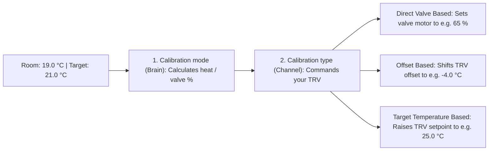

When configuring a radiator valve in Better Thermostat (Screen 2), you make **two separate choices** whose names sound similar:

1. **`Calibration mode` (The Control Brain):** *How much heat does the room need right now?* (8 algorithms to choose from)
2. **`Calibration type` (The Hardware Channel):** *How should Better Thermostat transmit that heat demand to your specific TRV?* (3 hardware methods)

Understanding this split clears up almost every mystery about what you see on your radiator's display.

---

## Part 1: `Calibration type` — How Better Thermostat talks to your TRV

Better Thermostat always offers **`Target Temperature Based`**, and automatically adds **`Direct Valve Based`** and **`Offset Based`** whenever your TRV hardware and integration expose those writable channels.

To see what each option actually sends over the radio, imagine this everyday snapshot:

- **Your desired target:** `21.0 °C`
- **External room sensor (on the table):** `19.0 °C` *(the room is `2.0 °C` too cold)*
- **TRV's internal sensor (next to the hot pipe):** `23.0 °C` *(reads `4.0 °C` too warm, so the TRV would close its valve on its own!)*

### 1. `Direct Valve Based` *(Highest precision — use when offered)*

- **What it sends:** Bypasses the TRV's internal thermostat loop and sets the valve motor position directly between **`0 %` and `100 %`** (capped by your TRV's `Valve Max Opening` slider), for example **`65 %`**.
- **What it brings:** Zero guesswork about how the TRV's own firmware reacts to offsets or setpoints. Enables fine proportional modulation without slamming the valve fully open and shut.
- **Supported hardware:** Offered automatically when your integration exposes a writable valve-opening entity or quirk—such as **Sonoff `TRVZB`** (Zigbee2MQTT), **Shelly BLU TRV** (Shelly integration via BLU Gateway Gen3), **Eurotronic Spirit Zigbee (`SPZB0001`)** & **Z-Wave (`ZWA021`)**, and several Danfoss/Popp/Hive TRVs in Zigbee2MQTT.
- **Compatible algorithms:** Works with the **5 valve-computing modes**: `(AI) Time Based (Default)`, `TPI Controller`, `(AI) MPC v2 (QP + Kalman, experimental)`, `PID Controller`, and `MPC Predictive (Beta)`.
  - If you pair `Direct Valve Based` with `Aggressive`, `External Sensor Offset Only`, or `No Calibration`, standard TRVs automatically fall back to setpoint control (`Target Temperature Based`). On valve-only TRVs like the **Shelly BLU TRV**, setup rejects incompatible modes—and if a stored configuration carries one, Better Thermostat returns a **`0 %` valve command** (raising a Home Assistant Repair warning and blocking heating, including `Boost`) until you select a compatible controller.
  - Activating the **`Boost`** preset opens direct-valve TRVs straight to `100 %` (or your `Valve Max Opening` limit).

### 2. `Offset Based` *(Local temperature calibration)*

- **What it sends:** Writes a calibration offset (for example **`-4.0 °C`**, plus any boost/throttling from the active algorithm) to the TRV's `number.<trv>_local_temperature_calibration` entity while keeping the TRV's target display at **`21.0 °C`**. The TRV now believes its `23.0 °C` pipe reading is `19.0 °C` and opens its valve.
- **What it brings:** The physical display on the radiator continues to show your real `21.0 °C` room target instead of shifted numbers.
- **Automatic external sensor mirroring:** On TRVs with a dedicated external-sensor register—such as **Sonoff `TRVZB`** and **Sonoff `TRV-ZBT` (Gen2)**—Better Thermostat also mirrors your room sensor's live temperature straight into the TRV automatically.

:::caution[Watch out for narrow hardware offset limits!]
Many TRVs clamp their local offset in firmware (for example `±2.5 °C` on Saswell `SEA801`/`SEA802`, `±5.0 °C` on Eurotronic Spirit, `-6.0 °C` on several Tuya models, or `-12.7 °C` on Sonoff TRVZB).

**What goes wrong:** If your radiator sits behind a curtain, sofa, or cover where trapped air reaches `27 °C` while the room is `19 °C` (`8 °C` difference), a TRV capped at `-5.0 °C` can only correct `27 °C` down to `22 °C`. It still thinks the room is warmer than `21 °C` and **stops heating while your room stays cold!**

**The fix:** Switch `Calibration type` from `Offset Based` to **`Target Temperature Based`** (or **`Direct Valve Based`** if available).
:::

### 3. `Target Temperature Based` *(Always available for setpoint-capable TRVs)*

- **What it sends:** Leaves the TRV's internal offset untouched and instead shifts the **target temperature** sent to the TRV—for example, sending **`25.0 °C`** (or higher depending on the algorithm's demand) so the TRV opens its valve despite reading `23.0 °C` at the pipe. As the room approaches `21.0 °C`, Better Thermostat lowers the TRV setpoint smoothly until the valve closes right on target.
- **What it brings:** Works reliably with Home Assistant `climate` entities that expose either a single target temperature or a target temperature range (including ZHA, tado°, HomematicIP without offset entities, and radiators hidden behind curtains or furniture because it is not restricted by narrow `±2.5–5 °C` offset caps).
- **What you'll notice on the TRV screen:** Seeing **`26 °C` or `30 °C`** on the radiator's physical display while heating is **completely normal and expected**. Better Thermostat is temporarily pulling the valve open and will throttle it back down before your room exceeds `21.0 °C`.

:::tip[How 0–100 % algorithms work on Offset Based and Target Temperature Based TRVs]
Even without `Direct Valve Based`, algorithms like `(AI) Time Based`, `TPI`, and `PID` still compute a `0–100 %` valve demand. Better Thermostat translates `0 %` into a setpoint/offset at the TRV's current temperature (closing the valve) and `100 %` toward the TRV's maximum setpoint (opening the valve), giving you smooth proportional modulation on ordinary TRVs ([Virtual hydraulic balancing](/deep-explanations/hydraulic-balance/)).
:::

---

## Part 2: Quick comparison of all 8 `Calibration mode` algorithms

Qualitative ratings below reflect the single-TRV `balanced` profile of Better Thermostat's thermal benchmark (`uv run python -m tests.benchmark.runner`); actual behavior depends on your room insulation, radiator sizing, hardware channel (`Direct Valve Based` vs. offset/setpoint), and room-sensor resolution (`0.1 °C` vs. `0.5 °C`).

| Exact UI name (`Calibration mode`) | Needs learning? | Overshoot protection | Warm-up speed | Valve & battery wear | Works with `Direct Valve`? | Uses `Overheating protection?` toggle? | Best for |
|---|---|---|---|---|---|---|---|
| **`(AI) Time Based (Default)`** | Yes (~2–3 cycles) | Good | Medium–Fast | Low | **Yes** | **Yes** (non-valve) | Everyday rooms; set-and-forget default |
| **`TPI Controller`** | **No** (instant) | **Very high** *(in steady rooms)* | Steady / Gentle | **Very low** *(steady proportional)* | **Yes** | No (built-in) | Bedrooms, well-insulated rooms, multi-TRV rooms, overshoot issues |
| **`(AI) MPC v2 (QP + Kalman, experimental)`** | Optional (`Auto` adapts) | **Very high** *(on direct valve)* | Fast & smooth *(direct valve)* | Low–Medium *(direct valve)* | **Yes (designed for it)** | No (built-in) | **Direct-valve TRVs** (Sonoff TRVZB, Shelly BLU, Spirit) |
| **`PID Controller`** *(Beta)* | Auto-Tune or manual | High *(once tuned, `≤0.2 °C` sensor)* | Fast *(direct valve)* | Medium–High *(higher on `0.5 °C` sensors)* | **Yes (best)** | No (built-in) | Sunny rooms, kitchens, hallways with sudden heat/cold swings (`0.1 °C` sensor) |
| **`Aggressive`** | No | Low (can overshoot) | **Fast** *(`+2.5 °C` boost, non-valve)* | Low–Medium | No (falls back) | **Yes** | Drafty, poorly insulated, or sluggish rooms where fast heat-up beats precision |
| **`External Sensor Offset Only`** | No | TRV's own loop | TRV's own loop | Very low | No (falls back) | No | Smart TRVs (e.g. tado°) whose internal controller you like—just fixes sensor bias |
| **`MPC Predictive (Beta)`** | Yes (continuous) | Medium | Fast | **High** | Yes | No | Earlier 30-min predictive beta; prefer **TPI** or **MPC v2** for most rooms |
| **`No Calibration`** | No | TRV's own loop | TRV's own loop | Lowest | No (falls back) | No | Using BT only for window/door pause, Summer Mode, presets, or grouping |

### Which algorithm should I choose in 15 seconds?

- **Just starting out?** Keep **`(AI) Time Based (Default)`** or pick **`TPI Controller`**. Both are rock-solid across standard radiators.
- **Room overshoots target, has multiple radiators, or drains batteries?** Pick **`TPI Controller`**.
- **Using a `Direct Valve Based` TRV (Sonoff TRVZB, Shelly BLU TRV, Spirit) and want cutting-edge predictive control?** Try **`(AI) MPC v2 (QP + Kalman, experimental)`** (or **`PID Controller`** if your room gets sudden sun/cooking heat and has a fast `0.1 °C` sensor).
- **Cold, leaky room takes forever to warm up?** Pick **`Aggressive`** (with `Overheating protection?` turned **On**).

Still unsure? Run the **[Interactive Configurator](/setup/configurator/)** for a tailored room profile.

---

## Part 3: What every algorithm does, brings, and causes

### 1. `(AI) Time Based (Default)`

- **In plain English:** Measures how fast *your specific room* actually warms up and cools down, then scales how wide it opens the radiator based on your room's thermal speed. *(Despite `(AI)` in the name, everything runs locally using transparent math—no cloud and no LLM.)*
- **How it works (concrete numbers):**
  Over normal heating and cooling phases, Better Thermostat tracks two diagnostic sensors on your device:
  - **`Heating Power`** (`0.005` to `0.2` °C/min, starting at `0.01`): how quickly the room warms when the radiator is hot.
  - **`Heat Loss`**: how quickly the room cools when heating is idle.

  Look at how differently `(AI) Time Based` opens the valve when your room is **`0.3 °C` below target**:

  | Room behavior | Learned `Heating Power` | Resulting valve demand at `0.3 °C` below target | Why? |
  |---|---|---|---|
  | Fast room / big radiator | `0.02 °C/min` | **~25 %** | Prevents overshooting a quick-heating room |
  | Average room (initial default) | `0.01 °C/min` | **~47 %** | Balanced mid-opening |
  | Slow, heavy, or cold room | `0.005 °C/min` | **~91 %** | Pushes hard so the room doesn't stall |

- **What `Overheating protection?` adds here (non-valve channels only):** On `Offset Based` and `Target Temperature Based` channels, once the room reaches target and goes `idle`, if residual radiator heat pushes the room past `target + tolerance`, Better Thermostat multiplies that excess by **`8×`** in the closing direction (e.g. `0.2 °C` past the band pushes the offset/setpoint by `1.6 °C` toward closed) so stubborn valves seal completely. *(When `(AI) Time Based` runs on `Direct Valve Based`, or when using direct controller modes like `TPI`, `PID`, or `MPC v2`, the `8×` post-adjustment does not apply because the valve closes to `0 %` directly.)*
- **Tips & maintenance:**
  - Turn on the **`Pause Learning`** switch while a wood stove/fireplace burns or while your boiler stops radiator flow for domestic hot water ([Pausing learning](/setup/pause-learning/)).
  - If you relocate your room sensor, bleed a previously air-locked radiator, or change your boiler's flow temperature, reset the learned speed via **Developer Tools → Actions → `better_thermostat.reset_heating_power`**.

---

### 2. `TPI Controller` *(Time-Proportional-Integral)*

- **In plain English:** Calculates a smooth `0–100 %` heating demand purely from two numbers—how far your room is from target right now, plus how cold it is outdoors—with **zero learning phase** and **minimal valve movement**.
- **Important clarification (no noisy on/off clicking!):** Classic electric TPI thermostats click a relay 100 % ON and 0 % OFF every few minutes. **Better Thermostat does NOT pulse your radiator valve open and shut.** Instead, it holds TPI's calculated percentage as a **steady proportional valve opening**, saving motor gears and batteries.
- **How it works (concrete numbers):**
  TPI combines `60 %` per `°C` of indoor temperature gap (`coef_int = 0.6`) with `1 %` per `°C` of indoor-to-outdoor temperature difference (`coef_ext = 0.01`).
  Suppose your **Target is `21.0 °C`** and your **Outdoor temperature is `5.0 °C`** (`16 °C` colder outside → `+16 %` steady heat-loss compensation):

  | Current room temperature | Gap to `21.0 °C` | TPI valve demand | What happens in the room |
  |---|---|---|---|
  | **`19.5 °C`** | `1.5 °C` too cold | **`100 %`** (`90 % + 16 %`, capped) | Full heat-up power |
  | **`20.5 °C`** | `0.5 °C` below target | **`46 %`** (`30 % + 16 %`) | Gently throttles down *before* hitting `21.0 °C` |
  | **`21.0 °C`** | `0.0 °C` (right on target!) | **`16 %`** (`0 % + 16 %`) | Holds a tiny steady trickle matching heat escaping outdoors—no sawtooth cycling! |
  | **`21.3 °C`** | `0.3 °C` above target | **`0 %`** | Shuts completely if sunlight or body heat warms the room |

  *(Without an outdoor sensor or weather entity, TPI still works great using just the `60 %` per `°C` indoor term, closing to `0 %` at `21.0 °C`.)*
- **Best for:** Bedrooms (ultra-quiet), well-insulated modern homes, rooms with 2+ radiators, and any room that overshoots with `(AI) Time Based` or `Aggressive`.

---

### 3. `(AI) MPC v2 (QP + Kalman, experimental)`

- **In plain English:** A physics-based predictive controller built specifically for **`Direct Valve Based`** TRVs. Like an experienced driver coasting before a red traffic light, it tracks how much heat is already stored inside the radiator metal and room air, predicting ahead so it closes the valve *before* thermal momentum overshoots your setpoint.
- **What it brings over simpler controllers:**
  - **Kalman state observer:** Estimates the hidden thermal inertia of your room (`MPC v2 Virtual Temperature`) and automatically adapts to coarse room sensors (such as `0.5 °C` step sensors) without staircase jumps in valve movement.
  - **Smooth quadratic-program (QP) horizon:** Penalizes both temperature error *and* unnecessary valve travel, keeping motors quiet.
  - **Automatic disturbance & parameter adaptation:** Tracks unmodeled heat gains like sunshine or people (`MPC v2 Disturbance`) and refines its room physics (`MPC v2 Coupling`, `MPC v2 Room Time Constant`) cleanly in the background once enough history accumulates.
- **Choosing `MPC v2 room size` (Screen 2):**
  - **`Auto` (Default):** Derives the initial room time constant from learned heat-loss behavior (falling back to a default ~`8 h` residential envelope) and re-identifies your room's exact thermal parameters over several days.
  - **`Small` / `Medium` / `Large`:** Fixes a starting thermal profile (`Small`: fast ~`3 h` envelope; `Medium`: standard ~`8 h` envelope; `Large`: slow ~`12 h` envelope) when you want a specific time-constant prior from Hour 1.
- **Diagnostic entities:** Enable the 4 opt-in sensors (`MPC v2 Virtual Temperature`, `MPC v2 Coupling`, `MPC v2 Disturbance`, `MPC v2 Room Time Constant`) on the device page if you want to inspect the live model ([Entities & attributes](/setup/entities/)).
- **Best for:** Rooms with **`Direct Valve Based`** TRVs (Sonoff TRVZB, Shelly BLU TRV, Eurotronic Spirit) where you want tight comfort with minimal overshoot. *(On `Offset Based` or `Target Temperature Based` TRVs, its fine 1–2 % valve adjustments get rounded by the TRV's `0.5 °C` setpoint grid—use `TPI Controller` or `(AI) Time Based` there instead.)*

#### Why MPC v2 does not use the flow temperature

Users with heat pumps or weather-compensated boilers often ask why MPC v2 has no setting or sensor input for radiator flow (supply) temperature.

Internally, MPC v2 models a reference `65 °C` heat source because **what determines the required valve opening is the ratio between flow temperature and radiator surface area**: a heat pump running `35 °C` water through oversized low-temperature radiators (or underfloor loops) needs almost the same steady valve percentage as a `65 °C` gas boiler feeding smaller classic radiators.

In Better Thermostat's 40-scenario thermal benchmark (`S29`, `S33`, `S39`, `S40`):
- Feeding a lower flow temperature *without* knowing the exact physical radiator wattage caused severe under-driving and nearly **4× more daily valve travel** on heat pumps (`0.108 K` vs `0.044 K` mean error).
- Even with a live flow-temperature sensor and matched radiator sizing, accuracy improved by just `0.016 °C`—far smaller than a room thermometer's own accuracy—while MPC v2's disturbance observer and `Auto` re-identification absorb gradual heating-curve shifts automatically.
- If your boiler temporarily stops heating radiators altogether (for example during a 45-minute domestic hot water cycle), use the **[Pause Learning switch](/setup/pause-learning/)** so no algorithm misinterprets cold pipes as room heat loss.

---

### 4. `PID Controller` *(Beta)*

- **In plain English:** Classic industrial cruise-control combining three reactions:
  - **P (`Proportional`):** Pulls harder the further the room is below target right now.
  - **I (`Integral`):** Slowly adds extra valve opening if a cold winter day leaves the room stubbornly `0.2 °C` below target for an hour.
  - **D (`Derivative`):** Hits the brakes as soon as room temperature starts rising fast (or when afternoon sun / cooking heats the room).
- **What you'll notice:** Tight setpoint holding and quick recovery from sudden disturbances, at the cost of **more frequent valve adjustments** (and slightly faster battery drain) than `TPI` or `(AI) Time Based`.
- **Best setup:** Shines with **`Direct Valve Based`** TRVs and a responsive room sensor reporting **`0.1 °C`** changes every 1–5 minutes. Avoid PID if your room sensor only updates in `0.5 °C` jumps (coarse steps cause derivative spikes).

#### Auto-tuning and manual tuning

When `PID Controller` is selected, Better Thermostat exposes four configuration entities on the device ([Entities & attributes](/setup/entities/)):

- **`PID Auto Tune`** (`switch`, **On** by default): Watches natural temperature crossings around your setpoint and automatically tunes P, I, and D gains (stored per `0.5 °C` target bucket, so `18 °C` night and `21 °C` day targets each keep their own learned gains). Expect **3–5 full heating oscillations** before Auto-Tune settles; during those first cycles, mild overshoot is normal.
- **`PID Kp (Proportional)`**, **`PID Ki (Integral)`**, **`PID Kd (Derivative)`** (`number` sliders): Show the active gains and let you fine-tune manually. **Important:** Changing any of the three gain sliders manually automatically switches **`PID Auto Tune` Off** so your manual tune is never overwritten!

| What you observe with PID | Manual adjustment |
|---|---|
| Room warms up too slowly | Increase **`PID Kp (Proportional)`** by 20–30 % |
| Room settles `0.2–0.4 °C` below target and stays there | Slightly increase **`PID Ki (Integral)`** |
| Room overshoots on initial heat-up | Lower **`PID Ki (Integral)`** and/or raise **`PID Kd (Derivative)`** |
| Valve hunts back and forth continuously | Lower **`PID Kp (Proportional)`** and **`PID Kd (Derivative)`** (or switch to **`TPI Controller`**) |
| Want a clean slate after changing radiators or sensors | Run action **`better_thermostat.reset_pid_learnings`** (enable `apply_pid_defaults` to restore baseline `Kp`/`Ki`/`Kd`) |

---

### 5. `Aggressive`

- **In plain English:** Built for speed over finesse. The moment your room drops below target (skipping the normal tolerance start delay!), `Aggressive` pushes an extra **`+2.5 °C` boost** onto the TRV (`+2.5 °C` target shift or `-2.5 °C` extra negative offset) to rip the valve wide open until the target temperature is reached.
- **What you'll notice:** Radiators get hot very fast, which feels great in cold, drafty, or rarely used rooms—but heavy cast-iron radiators or small well-insulated rooms will **overshoot** past the target once the valve shuts.
- **Important notes:**
  - Always keep **`Overheating protection?` turned On** with `Aggressive` so Better Thermostat forces the valve shut (`8×` closing push) if residual heat carries the room past `target + tolerance`.
  - `Aggressive` does **not** calculate a `0–100 %` valve percentage; do not pair it with `Direct Valve Based`.

---

### 6. `External Sensor Offset Only` *(formerly called "Normal")*

- **In plain English:** Pure 1-to-1 thermometer correction—nothing more. If your room sensor reads `19.0 °C` and the TRV reads `23.0 °C`, Better Thermostat tells the TRV *"the temperature is `4.0 °C` lower than you think"* and leaves 100 % of the heating decisions to the TRV's own built-in firmware.
- **Key difference from every other mode:** `External Sensor Offset Only` applies **no tolerance band**, **no boost**, **no learning**, and **no `Overheating protection?` hook**. Every meaningful room-sensor update refreshes the offset/setpoint mapping directly.
- **Best for:** Premium TRVs (such as tado° or modern Danfoss Ally valves) whose built-in internal PID controller you already love, when all you want is to replace their biased radiator-side thermometer with your room sensor plus Better Thermostat's window pause, Summer Mode, and presets.

---

### 7. `MPC Predictive (Beta)`

- **In plain English:** Better Thermostat's first-generation 30-minute thermal model (`MPC Gain`, `MPC Loss`, `MPC Insulation (Ka)`, `Virtual Temperature`).
- **Should I use it?** In Better Thermostat 2.0's thermal benchmark suite, `MPC Predictive (Beta)` moves the valve motor noticeably more often than `TPI` or `PID`, does not beat them on overshoot, and can over-react when a room has multiple radiators.
  - For **`Direct Valve Based`** TRVs, choose **`(AI) MPC v2 (QP + Kalman, experimental)`** instead.
  - For **`Offset Based`** or **`Target Temperature Based`** TRVs, choose **`TPI Controller`** or **`(AI) Time Based (Default)`** instead.

---

### 8. `No Calibration`

- **In plain English:** Passes your exact target temperature (`21.0 °C` → `21.0 °C`) straight through to the TRV without shifting its offset, setpoint, or valve percentage. *(Unlike `External Sensor Offset Only`, the configured `Tolerance` band still gates when Better Thermostat switches between heating and idle.)*
- **Best for:** Setups where your TRV **already receives an external room sensor natively** (for example via a direct Zigbee binding or manufacturer bridge) and you only want Better Thermostat's **wrapper features**: window & door pause, 24h-damped Summer Mode, multi-TRV room grouping, presets, child lock, and fail-soft monitoring.
