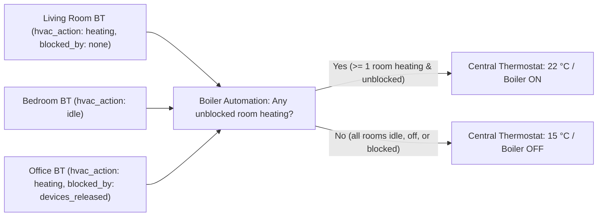

Better Thermostat controls **radiator valves (and optional room coolers) room by room**—it never switches a central gas boiler, zone pump, or heat pump directly.

If your home has **both** room radiator TRVs **and** a central wall thermostat (or boiler demand relay), keep the central unit **outside** every Better Thermostat room and let a small Home Assistant automation fire the boiler whenever *at least one room* actively asks for heat.



## Why leaving the central thermostat on its own schedule causes overshoot

A very common mistake is leaving a hallway wall thermostat on its own timer or hallway thermometer:

1. Once the warm hallway hits `20 °C`, the central thermostat shuts off the boiler pump—even though a colder north office is still at `18.5 °C`.
2. Because no hot water reaches the office radiator, Better Thermostat sees the office failing to warm up and **opens the office valve wider and wider** (the right decision when trying to heat a cold room!).
3. Hours later, when the hallway finally cools and fires the boiler again, the office valve is wide open and **blasts into a `1.5–2.0 °C` overshoot**!

Driving the central boiler from the rooms' combined demand eliminates that hidden ceiling completely. *(And if your boiler periodically stops radiator flow for 30–60 minutes to heat domestic tap water, use the **[Pause Learning switch](/setup/pause-learning/)** so learning algorithms don't misread cold pipes!)*

---

## The right signal: `hvac_action == 'heating'` and `heating_blocked_by` is `none`

Watch both **`hvac_action`** and **`heating_blocked_by`** on all of your Better Thermostat entities. Enable the boiler only when at least one room reports **`hvac_action == 'heating'`** *and* **`heating_blocked_by` is `none`** (`is none` in Jinja2 templates—meaning no active block such as `devices_released`, `valve_maintenance`, or `startup`, which can publish a block without running a control cycle that clears `hvac_action`). Include `heating_blocked_by` state changes in your automation triggers so the boiler decision reevaluates immediately whenever a block starts or clears.

:::danger[Never use call_for_heat to trigger your boiler!]
`call_for_heat` is only the **Summer Mode** outdoor-weather flag (`true` all winter long even when every room is already warm at `21 °C`!). Driving a boiler from `call_for_heat` will run your boiler 24/7 all winter. Always require **`hvac_action == 'heating'`** together with **`heating_blocked_by` being `none`**.
:::

### Example A: Driving a central `climate` wall thermostat

```yaml
triggers:
  - trigger: state
    entity_id:
      - climate.living_room
      - climate.bedroom
      - climate.office
    attribute: hvac_action
  - trigger: state
    entity_id:
      - climate.living_room
      - climate.bedroom
      - climate.office
    attribute: heating_blocked_by
  - trigger: homeassistant
    event: start
actions:
  - action: climate.set_temperature
    target:
      entity_id: climate.central_thermostat
    data:
      temperature: >
        {{ 22 if expand('climate.living_room', 'climate.bedroom', 'climate.office')
             | selectattr('attributes.hvac_action', 'eq', 'heating')
             | selectattr('attributes.heating_blocked_by', 'none')
             | list | count > 0
           else 15 }}
```

- Replace `22` and `15` with setpoints your central wall thermostat reliably treats as *"fire boiler"* and *"stand down"*.
- **Keep the central thermostat in `heat` mode:** `climate.set_temperature` does not wake a thermostat sitting in `off` (if yours switches modes, call `climate.set_hvac_mode` as a separate action before `climate.set_temperature`).
- **Keep the `homeassistant` `start` trigger:** Without it, after a Home Assistant restart the central thermostat could stay stuck in its pre-restart state until the next room transitions between `heating` and `idle`.

### Example B: Driving a dry-contact boiler `switch` relay

```yaml
triggers:
  - trigger: state
    entity_id:
      - climate.living_room
      - climate.bedroom
      - climate.office
    attribute: hvac_action
    for:
      minutes: 1
  - trigger: state
    entity_id:
      - climate.living_room
      - climate.bedroom
      - climate.office
    attribute: heating_blocked_by
    for:
      minutes: 1
  - trigger: homeassistant
    event: start
actions:
  - action: >
      switch.turn_{{ 'on' if expand('climate.living_room', 'climate.bedroom', 'climate.office')
        | selectattr('attributes.hvac_action', 'eq', 'heating')
        | selectattr('attributes.heating_blocked_by', 'none')
        | list | count > 0 else 'off' }}
    target:
      entity_id: switch.boiler_heat_demand
```

---

## A note on weather-compensated flow temperature

Better Thermostat does not modulate boiler flow temperature. If your heat pump or condensing boiler adjusts its supply water temperature automatically, keep it on a **slow outdoor weather-compensation curve** rather than fast indoor feedback: rapid flow-temperature swings disturb every room loop simultaneously and cause hunting. For room-to-room heat distribution, see **[Virtual hydraulic balancing](/deep-explanations/hydraulic-balance/)**.
