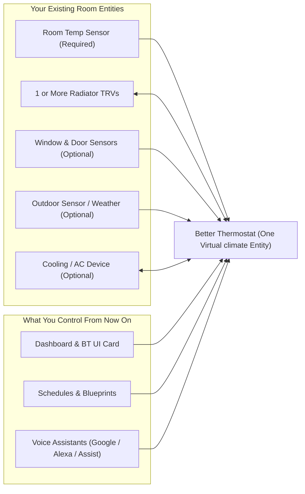

import { Card, CardGrid } from '/node_modules/@astrojs/starlight/components';

## Why Better Thermostat exists

Every smart radiator thermostat (TRV) has the same physical flaw: **its built-in thermometer sits millimeters away from a 55–70 °C hot water pipe.**

Within minutes of opening the valve, trapped heat around the radiator makes the TRV read **23 °C** and throttle back—even though your sofa in the middle of the room is still **19 °C**. Behind curtains, covers, or furniture, the heat pocket is even worse and the room never reaches your target temperature.

Better Thermostat fixes this by wrapping your radiator valves and a **separate room temperature sensor** into **one virtual `climate` entity** in Home Assistant.

### The Golden Rule

Once a room is set up, **all dashboards, schedules, automations, and voice assistants control only the `Better Thermostat` entity**—never the physical TRVs directly.

If someone turns the physical knob on a radiator by hand, Better Thermostat detects that manual change and adopts the new target temperature automatically (unless you turn on the **Child Lock** switch).

---

## What it does vs. what it intentionally does NOT do

Better Thermostat separates **HOW** a room reaches and holds its temperature from **WHEN** you want that temperature scheduled:

| What Better Thermostat DOES ("HOW to heat") | What it intentionally DOES NOT DO ("WHEN to heat") |
|---|---|
| **True room-center control:** Continuously corrects your TRV using its calibration offset, target setpoint, or direct 0–100 % valve position. | **No built-in timetable:** Presets (`Comfort`, `Eco`, `Sleep`, `Away`) hold temperatures, not clock times. Use the bundled [Weekly Heating Schedule blueprint](/setup/automation-blueprints/), HA Schedule helpers, or *Advanced Heating Control*. |
| **Multi-radiator grouping:** Drives 2, 3, or more TRVs in one large room as a single synchronized thermostat. | **Does not switch your central boiler / heat pump directly:** If your boiler needs a demand signal, add a small automation watching `hvac_action == 'heating'` ([guide](/deep-explanations/central-heating-thermostat/)). |
| **8 control algorithms:** From zero-tuning **TPI** and self-learning **(AI) Time Based** to **PID** and physics-based **(AI) MPC v2** for direct-valve TRVs. | **Cannot run without a separate room sensor:** A standalone room temperature sensor away from the radiator is mandatory. |
| **Automatic energy guards:** Debounced window & door pause, 24h-damped **Summer Mode** outdoor cutoff, and coordinated AC cooling without heating/cooling fights. | **Does not replace Zigbee / Z-Wave integrations:** Pair your hardware first in Zigbee2MQTT, ZHA, Shelly, HomematicIP, Z-Wave JS, tado°, or deCONZ—Better Thermostat wraps the entities they expose. |
| **Fail-soft & battery-safe:** Spaces radio writes to save TRV batteries and steps down safely (`optimal` → `sensor_fallback` → `hold`) if a room sensor battery dies. | **Does not regulate by humidity:** Humidity is displayed on the entity and triggers ventilation/alert blueprints, without altering target temperatures. |

---

## Highlights in Better Thermostat 2.0

- **Fail-soft protection:** If a room sensor drops offline, Better Thermostat automatically falls back to the average of your TRVs' internal sensors (`sensor_fallback`) instead of leaving the room uncontrolled, and surfaces a self-clearing Home Assistant Repair warning ([Degraded mode](/faq/degraded-mode/)). Offline window or door sensors count as closed so dead batteries never freeze a room.
- **`(AI) MPC v2` for Direct-Valve TRVs:** New Kalman-observer + quadratic-program predictive controller built specifically for direct-valve TRVs (such as Sonoff TRVZB, Shelly BLU TRV, and Eurotronic Spirit) to anticipate thermal inertia and prevent overshoot.
- **24-hour damped Summer Mode:** Outdoor sensors and weather forecasts are smoothed over 24 hours with a `1.0 °C` (`1.8 °F`) hysteresis margin so cool mornings or sunny sensor spikes no longer flip heating on and off erratically ([Summer mode explained](/deep-explanations/summer-mode/)).
- **Separate Door Sensors, Pause Learning & Device Release:** Configure independent open/close delays for interior doors, freeze model learning while a fireplace burns or the boiler heats tap water ([Pausing learning](/setup/pause-learning/)), or hand TRVs back to manual control with one switch ([Releasing devices](/setup/releasing-devices/)).

Already running version 1.9? Read **[Upgrading from 1.9 to 2.0](/setup/upgrading-to-2-0/)**.

---

## Where to go next

<CardGrid stagger>
  <Card title="1. Install in 5 minutes" icon="rocket">
    Check your prerequisites, place your room sensor properly, and set up your first room in [5-minute quickstart](/setup/getting-started/).
      
    
  </Card>
  <Card title="2. Understand types & algorithms" icon="puzzle">
    Finally understand the difference between **Calibration type** (how BT talks to your TRV) and **Calibration mode** (the 8 control brains) with concrete numbers in [Calibration types & algorithms](/calibration_algorithms/).
  </Card>
  <Card title="3. Find your room's ideal settings" icon="setting">
    Answer 6 quick questions about your room and TRV in the [Interactive Configurator](/setup/configurator/) or grab proven profiles in [Recommended settings](/optimal-settings/recommended-settings/).
  </Card>
  <Card title="4. Check hardware & Zigbee tips" icon="approve-check">
    Compare Zigbee2MQTT vs. ZHA, Direct Valve support, Shelly BLU TRV, and built-in model quirks in [Supported devices](/working-devices/compatibility/) and [Recommended TRVs](/working-devices/recommended-devices/).
  </Card>
  <Card title="5. Add schedules & boiler control" icon="list-format">
    Import one-click [Automation Blueprints & schedules](/setup/automation-blueprints/) or connect a central wall thermostat / gas boiler in [Central heating & boiler control](/deep-explanations/central-heating-thermostat/).
  </Card>
  <Card title="6. Fix a misbehaving room" icon="warning">
    Radiator staying cold, overheating, or showing `30 °C` on the display? Check the symptom-by-symptom table in [Troubleshooting & FAQ](/faq/common-questions/) or [Support the project](/support/).
  </Card>
</CardGrid>
