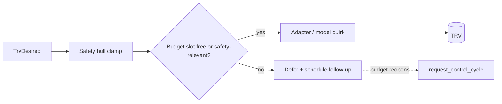

TRVs are battery- and radio-constrained devices, and writes get lost on
the air. Two mechanisms address this pair of facts: the **write
budget** spaces writes out, the **reconciler** heals the ones that got
lost. Deciding is never throttled; only the radio traffic is.

## The write path

A cycle writes only differences: a device already matching the intent
gets no write. For each TRV the shell translates the intent per channel
(HVAC mode, setpoint, calibration offset, valve percentage) through the
safety hull, the write budget, and finally the device adapter:

The setpoint is compared on the device's grid. Before the comparison it
is rounded onto the TRV's step and clamped to its range, exactly as the
adapter write would round and clamp it, so a target between two steps
(70 °F is 21.11 °C) is written once and then matches the value the TRV
holds instead of going out again every cycle.

**Adapters** (`adapters/`) speak the integration's dialect: Zigbee2MQTT,
deCONZ, Tado, ZHA, Z-Wave JS, Shelly, generic climate services.
Zigbee2MQTT, ZHA, Z-Wave JS and the Shelly BLU TRV publish the valve as a
number entity of its own, and `adapters/valve_entity.py` serves that valve
channel for all four.
**Model quirks** (`model_fixes/`) override single operations for
devices that need special sequences (for example valve writes on the
Sonoff TRVZB). The `Trv` object carries both, plus a `TrvCapabilities`
descriptor derived in one place (whether the device supports offset
writes, direct valve writes, and an OFF mode), so the rest of the code
consults capabilities instead of probing quirk modules.

Home Assistant puts no time limit on a service call, and some
integrations keep the call open until the device answers (a sleeping
Z-Wave node, a cloud API without a request timeout). The heads of a
room and the cooler are written one after another under one lock, so
every device write, adapter, quirk and cooler alike, is bounded at 30
seconds (`DEVICE_CALL_TIMEOUT_S`). A write that runs out of time is
cancelled and fails like one that raised: it is not repeated within the
cycle, the channel is logged as out of reach, and each following cycle
tries it once until a write goes through. The other heads of the room
keep getting their writes. A head that stops answering still costs the
room up to 30 seconds per channel it is written on (mode, setpoint,
offset, valve) in every cycle.

A mode write that ran out of time may still reach the device: a
sleeping node keeps the command queued and applies it when it wakes.
Such a mode is remembered as withdrawn for the confirmation window,
like a command the room took back before the device confirmed it, so
the device applying it late is not read as someone switching the mode
at the device. The head's setpoint and offset are still written in the
same cycle.

At startup, each TRV's initial tweak has a 60-second budget; a TRV whose
tweak runs out of time counts as failed and the startup moves on.

## Released devices

While the *Release devices* switch is on, the kernel's intent is marked as
released and addresses no device. A control cycle then neither controls a
TRV nor runs the cooling channel, and the reconciler queues nothing. The
writes outside the control cycle stand down as well: the external room
temperature and its keepalive, the steps of a valve maintenance run, the
child lock, and the initialisation of a TRV at startup, which waits for
the devices to be taken back. A cycle decides once and then awaits its
writes one after the other, so each TRV and cooler write, and each
write of a TRV's initialisation, checks the switch itself right before
it goes out: a release that comes in while a cycle or an initialisation
is under way ends the writes that follow, and a write already sent
completes. The same holds inside a write: each attempt of the retry
chain, the next valve channel, the mode an offset write restores, the
preset or sensor selector a model quirk pairs with its command, the
deferred close after a TRVZB valve bump, and the external temperature
for the next TRV each check the switch before they go out. Taking them
back requests one control cycle, which writes the differences like any
other.

A TRV released on its own goes through the same checks, keyed by its
entity id: every write above asks whether the room's devices or this TRV
are released (`device_released()`), so a cycle and the writes outside it
pass the released TRV over and serve the others. The kernel drops the TRV
from its intents, the control queue does not dispatch it, the mode cache
refresh at the end of a cycle and the reading of reports held during it
leave it alone, and the reconciler, which compares only addressed TRVs,
never sees it. A cooler that is also one of the room's TRVs is released
with it.

## The write budget

Non-safety writes to one TRV keep a minimum spacing of 30 seconds,
**per channel** (setpoint, offset, valve), so one channel's writes
cannot starve another's slot. A TRV with the HomematicIP option enabled
gets ten minutes instead, since its head shares the access point's 1 %
radio duty cycle; the first setpoint write after the user changes the
target or mode still goes out at the 30-second pace. HVAC-mode
commands, OFF included, do not go through the budget at all.
Safety-relevant writes on a budgeted channel (the minimum setpoint
that stands in for OFF on a TRV without an off mode, frost-floor rewrites, closing the valve) always
bypass the budget but still stamp the slot, so the spacing stays
accurate.

A deferred write is not dropped on any of the three channels: the
defer path schedules one coalesced control cycle for the moment the
budget reopens, and that cycle re-derives the value. A valve write the
device rejected after the budget was spent schedules the same catch-up
cycle. The follow-up is needed because the reconciler compares against
the last value actually written, which the device still matches.

The valve write decision skips a write only when the last value sent
equals the target and the entities that write set still report it, or
report nothing it could be checked against. A valve entity whose state is
`assumed_state` only repeats what was sent, so every cycle asks for the
write again, and it goes out whenever the valve channel's budget allows. That holds for a close as
well: a repeated close that only an assumed state reports waits for its
slot instead of bypassing the budget. A closed valve the device reports
open again is closed again at once, once per report; the next close waits
for the device's next position report.

The setpoint write decision compares the intent with the setpoint the
device **reports**, not with the last value sent, so a setpoint the device
did not take is written again by the next cycle. A device that keeps
reporting something else would be written on every cycle, so the setpoint
channel backs off: the writes since the device was last seen holding,
within one of its steps, the intended or the last written value form a
run. The second write of a run follows at the channel's interval, and every
further one waits twice as long as the one before, up to one hour.
A user change of target or mode since the last write skips the backoff
once. After six writes of a run the TRV is listed in the thermostat's
`errors` attribute and gets a `setpoint_not_applied` repair issue; both go
away when the device is seen holding the value. A report without a
readable setpoint neither extends nor ends a run.

The offset channel writes no differently when the offset runs out of
range, but it watches for that. A cycle continues a run of such cycles
(`core/offset_limit.py`) when its offset intent, after the safety hull,
and the reported offset both lie within one offset step of the same limit
of the range the hull clamps to, and the correction the gap between room
temperature and TRV reading asks for (the gap plus the offset held, or the
negated gap for a TRV that shifts its setpoint) lies more than a step past
that limit. A calibration mode or overheating protection that holds the
offset at a limit on a TRV that applies it leaves that correction inside
the range. A run that lasts an hour gives the TRV a
`calibration_offset_at_limit` repair issue and logs one warning; a cycle
that finds any of the three otherwise ends the run and takes the issue
back. The run comes off the TRV at the start of every `control_trv` call
and goes back only through the offset block, so a cycle that returns early
or follows no offset ends it, and a raised issue stays in place. An offset
entity that is unavailable or unknown counts as no report.

## The reconciler

Every five minutes, `reconcile_tick` runs the same observe-decide step
as a control cycle (without a flight-recorder entry) and compares the
intent against what the devices report:

- **mode** — an OFF intent against a device reporting a heating mode
  (devices that cannot switch off legitimately stay in a heating mode
  at their minimum temperature and are compared by setpoint instead),
  and a heating intent against a device reporting OFF,
- **setpoint** — the last commanded value against the reported target,
  with a tolerance of half the device-reported step (at least 0.05 K),
  so firmware snapping a value onto its own coarser grid still counts
  as a match,
- **offset** — the commanded calibration against the calibration
  entity, once the device confirmed the last write (in-flight writes
  remain the write path's business),
- **valve** — what the last valve write sent against every entity it
  set, in that entity's own units. An adapter write is read back from
  the valve number entity, against the commanded percentage scaled onto
  the `min`, `max` and `step` that entity publishes, exactly as the
  write scaled it; a quirk write from the numbers the quirk names, such
  as both the opening and the closing degree of a Sonoff TRVZB, against
  the values the quirk sent. The tolerance is 5 % of the entity's range
  either way, and at least one step below: ZHA truncates a number onto
  its grid, so a write can land one step below the value sent, while no
  device rounds a value already on the grid upwards. An
  entity that publishes no usable range is not read. An entity whose state is
  `assumed_state` repeats the last command sent to it, so a matching one
  confirms nothing and is no divergence either; a different one means a
  later command replaced BT's,
- **cooler mode** — the mode a cooler of its own reports against the
  COOL or OFF the cooling channel last decided. A cooler that also
  carries the heating role is compared as a TRV instead.

On divergence the reconciler queues one ordinary control cycle, the
general healing mechanism that replaces per-case keepalives. The
tolerances matter: a reconciler that fights device quantization
or normal modulation would re-send the same value every five minutes
and drain batteries, which is what the budget exists to prevent.

The same tick hosts the watchdog check: if no control cycle completed
for 15 minutes, it logs an error and forces one. A cycle that is still
running 15 minutes after it began is logged as an error once.
