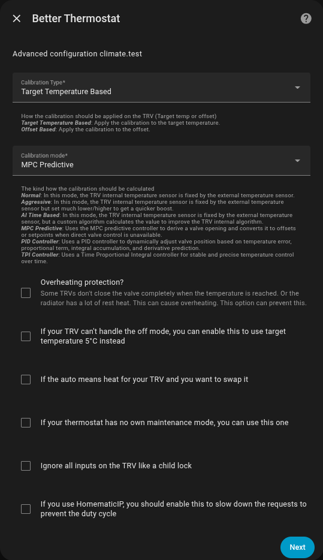

When you add Better Thermostat in Home Assistant (**Settings → Devices & Services → Add Integration → Better Thermostat**) or click **Configure** on an existing room, Home Assistant shows a **two-screen dialog**.

:::tip[Looking for the full reference of every edge case?]
This page walks you through setting up a room quickly. For detailed rules on every single field, see **[All settings reference](/configuration/)**, or generate a room-specific recommendation in the **[Interactive Configurator](/setup/configurator/)**.
:::

---

## Screen 1: Your room, sensors, and comfort limits

### Required fields (only three!)

1. **`Name`** — The room name (for example `Living Room`). Home Assistant creates `climate.living_room` and attaches all helper switches, sliders, and diagnostic sensors to this device.
2. **`The real thermostat`** — Select **all** radiator valves (TRVs) in this room. Better Thermostat synchronizes multiple TRVs in the same room automatically—never create two separate Better Thermostat entries for one open room.
3. **`Room temperature sensor`** — Your external thermometer placed in the room (`1.2–1.5 m` high, away from radiators, direct sun, and drafts).

### Optional sensors & comfort settings

- **`The cooling device (optional)`** — Add an air conditioner (`climate.*`) if the room has both radiators and cooling. Better Thermostat switches your presets to separate heating (`Min`) and cooling (`Max`) sliders and prevents heating and cooling from fighting each other.
- **`Humidity sensor`** — Displays live room humidity on the thermostat entity and powers the `humidity_high` device trigger and High Humidity Alert [blueprint](/setup/automation-blueprints/).
- **`Window sensor`** & **`Door sensor`** *(plus their open/close delays)* — Pause heating while airing out the room.
  - **Recommended delays:** Set **Window** open/close delays to **`120`–`180` seconds** (2–3 min) and **Door** open delay to **`240`–`300` seconds** (4–5 min) so walking through a door does not cycle your valve motors.
  - In Better Thermostat 2.0, an offline (`unavailable`) window or door sensor counts as **closed** so a dead coin-cell battery never leaves your room freezing.
- **`Outdoor temperature sensor`** *or* **`Weather entity to get the outdoor temperature`** *(plus **`The outdoor temperature when the thermostat should turn off`**)* — Automatic **Summer Mode**.
  - If both are filled in, the **Outdoor temperature sensor** takes priority.
  - **Recommended threshold:** Set **`15`–`17` °C** instead of the `20 °C` starting value, because Better Thermostat smooths outdoor readings over **24 hours including cool nights** ([Summer mode explained](/deep-explanations/summer-mode/)).
- **`Tolerance, to prevent the thermostat from turning on and off too often`** — **Change this from `0.0` to `0.3` °C** (`0.5 °C` for underfloor heating). At `21.0 °C` target with `0.3 °C` tolerance, Better Thermostat heats to `21.0 °C` and rests quietly until the room cools to `20.7 °C`. *(You can also adjust `Tolerance` and `Outdoor Temperature Threshold` live later via `number` entities on the device page without reloading!)*
- **`Availability guard`** *(and grace period)* — Leave empty for standard battery TRVs. Only needed if your thermostats lose electrical power whenever your central boiler or heat pump turns off ([Missing entity & availability guard](/faq/missing-entity/)).
- **`Target minimum temperature`**, **`Target maximum temperature`**, **`Target temperature step`** — Leave min/max on `Auto` unless you want to restrict how low or high family members/voice assistants can set the dial.
- **`Enabled Presets`** — Pick which preset buttons appear on your thermostat card (`Eco` is enabled by default; enable `Comfort`, `Sleep`, and `Away` if you plan to use the [Weekly Heating Schedule blueprint](/setup/automation-blueprints/)).

### Combining multiple window or door sensors in one room

If a room has two or three windows, combine them into one `binary_sensor` before opening Better Thermostat's setup:

**Recommended (No YAML, no restart):**
1. Go to **Settings → Devices & Services → Helpers** (top tab).
2. Click **+ Create Helper → Group → Binary sensor group**.
3. Name it (e.g. `Living Room Windows`), leave **All entities** turned **Off** *(so any single open window reports the group as open)*, add your window contacts, and click **Submit**.

*(YAML alternative in `configuration.yaml` if you prefer text files:)*
```yaml
binary_sensor:
  - platform: group
    name: "Living Room Windows"
    device_class: window
    all: false
    entities:
      - binary_sensor.livingroom_window_left
      - binary_sensor.livingroom_window_right
```

---

## Screen 2: Per-thermostat hardware & algorithm options

If you selected multiple TRVs on Screen 1, Screen 2 repeats once **for each TRV**, because you can mix different TRV brands in the same room!

1. **`Calibration type`** *(how Better Thermostat commands this TRV)*:
   - Pick **`Direct Valve Based`** if offered (Sonoff TRVZB, Shelly BLU TRV, Eurotronic Spirit).
   - Otherwise keep **`Offset Based`** (if offered and radiator stands in the open), or pick **`Target Temperature Based`** if the radiator sits behind curtains/furniture or your TRV has a narrow `±2.5–5 °C` firmware offset limit.
2. **`Calibration mode`** *(the control algorithm)*:
   - Keep **`(AI) Time Based (Default)`** or choose **`TPI Controller`** for everyday rooms.
   - Choose **`(AI) MPC v2 (QP + Kalman, experimental)`** (and set **`MPC v2 room size`** to `Auto`) to get predictive control on **`Direct Valve Based`** TRVs.
   - Read **[Calibration types & algorithms](/calibration_algorithms/)** for side-by-side numerical examples of all 8 modes.
3. **Hardware checkboxes (leave off unless your TRV needs them):**
   - **`Overheating protection?`** — Keep **On** (default). Helps close leaky valves in `(AI) Time Based` and `Aggressive` modes if residual radiator heat carries the room past `target + tolerance`.
   - **`Use the minimum temperature instead of 'off'`** — Enable only if your TRV ignores `off` commands, or if turning the physical TRV knob all the way down to its minimum temperature should switch Better Thermostat off.
   - **`If 'auto' means 'heat' for your TRV and you want to swap it`** — Enable only for TRVs where Home Assistant's `heat` mode triggers an unwanted full-open boost while `auto` is normal regulation.
   - **`If your thermostat has no own maintenance mode, you can use this one`** — Periodically exercises the valve pin so lime scale doesn't seize it over the summer.
   - **`Ignore all inputs on the TRV like a child lock`** — Reverts manual knob turns on the radiator (can also be toggled anytime via the `Child Lock` switch entity on the device).
   - **`If you use HomematicIP, you should enable this to slow down the requests to prevent the duty cycle`** — Automatically pre-checked for Homematic integrations; spaces background radio writes to 10 minutes so your 868 MHz CCU/Access Point never hits its 1 % airtime limit.

## Screen 2: Calibration and behavior

<div style="display: grid; grid-template-columns: repeat(auto-fit, minmax(300px, 1fr)); gap: 2rem; align-items: start;">

<div>



</div>

<div>

### Calibration type

How should Better Thermostat control your radiator?

- **Target Temperature Based**: The safest choice. It tricks your radiator into heating more or less by changing its target temperature. Works with almost all devices.
- **Offset Based**: Uses your device's built-in calibration feature, if it has one. Preselected when your device supports it.
- **Direct Valve Based**: Sets the valve opening directly. Only offered when Better Thermostat can write your device's valve, through a writable valve position entity or a valve control built in for that model, and only AI Time Based, MPC Predictive, MPC v2, TPI Controller and PID Controller use it; the other modes fall back to a target temperature.

Some devices expose offset as a `number`, others as a `select`. Better Thermostat supports both.

### Calibration mode

This is the "brain" of Better Thermostat. How should it calculate the heating?

- **(AI) Time Based (Default)**: **Recommended for most users.** A smart algorithm that learns and adjusts to keep the temperature stable.
- **External Sensor Offset Only**: Basic mode. It just syncs the temperature from your room sensor to the radiator.
- **MPC Predictive (Beta)**: Predicts how your room heats up and sets its correction ahead of time. Still in testing.
- **(AI) MPC v2 (QP + Kalman, experimental)**: An experimental predictive controller. It sets the valve directly with Direct Valve Based and otherwise steers through the target temperature or the offset.
- **Aggressive**: Heats up faster by pushing the radiator harder while heating, but might overshoot your target temperature.
- **TPI Controller**: Turns the temperature error into a duty cycle and holds the valve open by that share.
- **PID Controller**: A mathematical approach that constantly adjusts the valve. Best for advanced users.
- **No Calibration**: Passes your target temperature to the radiator unchanged.

**MPC v2 room size**: Only used by MPC v2. Leave it on *Auto* unless you want it to start from a fixed small, medium or large room model.

Use [Algorithm selection](/optimal-settings/algorithm-selection/) for decision help.

### Other important toggles

- **Overheating protection?**: On by default. Helps if your room keeps getting too hot even after reaching the target temperature (often happens if radiators stay hot for a long time). It only acts in the AI Time Based and Aggressive modes.
- **Use the minimum temperature instead of 'off'**: Sends the TRV its lowest supported target temperature instead of switching it off, and treats a TRV turned to that temperature as off; the room switches off once every TRV in it is off. The minimum BT sends on its own, for example in warm weather or with a window open, does not count, nor does a turn at a TRV with the child lock; BT turns such a TRV back. A turn while a window or door is open does count: BT keeps it as the room's setting, turns the TRV back to its minimum, and heats to the new target once every window and door is closed. A TRV that lists no "Off" mode gets the minimum temperature automatically, but counts as off at that temperature only with this option; enable the option when the "Off" mode your TRV lists does not work, or when turning the knob of a TRV without one should switch BT on and off.
- **If 'auto' means 'heat' for your TRV and you want to swap it**: Fixes a quirk with some specific thermostat brands where the modes are mixed up in Home Assistant.
- **If your thermostat has no own maintenance mode, you can use this one**: Adds a maintenance mode (like opening the valve fully to prevent it from getting stuck in summer) if your device lacks one.
- **Ignore all inputs on the TRV like a child lock**: Acts like a child lock. Changes made directly on the physical radiator valve will be ignored.
- **If you use HomematicIP, you should enable this to slow down the requests to prevent the duty cycle**: Turn this on if you use HomeMatic devices to prevent them from being overwhelmed with too many commands (duty cycle limit). It is already on when the device's integration is a HomeMatic one.

</div>

</div>
