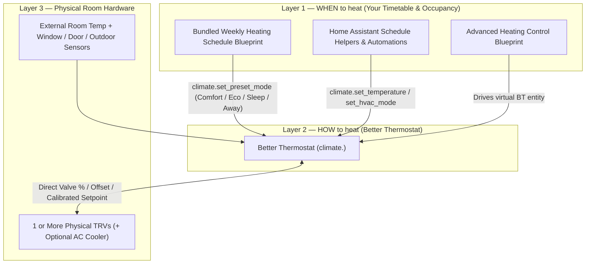

## How Better Thermostat fits into Home Assistant

Smart heating in Home Assistant splits naturally into **two layers**:

- **Better Thermostat owns Layer 2 ("HOW to heat"):** It reads your room sensor, pauses for open windows/doors, suppresses heating during warm 24h-smoothed outdoor weather, coordinates multiple radiators (and an optional AC cooler), spaces out radio commands to protect batteries, and computes the exact valve opening, offset, or setpoint each TRV needs.
- **Home Assistant automations own Layer 1 ("WHEN to heat"):** Clock timetables, presence setbacks, and holiday modes tell `climate.<your_bt_room>` *which preset or target temperature* should apply right now.

### Combining Better Thermostat with other Home Assistant tools

- **Better Thermostat UI Card (Frontend companion):** Available in HACS under *Frontend* ([`better-thermostat-ui-card`](https://github.com/KartoffelToby/better_thermostat_ui_card)). Shows open-window icons, Summer Mode status, ambient humidity, and dual heating/cooling dials. *(In UI Card **v3.0+**, use `custom:better-thermostat-normal-climate-card` or `custom:better-thermostat-mini-climate-card` in YAML instead of the retired `custom:better-thermostat-ui-card` tag.)*
- **Bundled Blueprints vs. *Advanced Heating Control (AHC)*:**
  - Out of the box, Better Thermostat ships **9 ready-made [Automation Blueprints](/setup/automation-blueprints/)**, including a 4-slot **Weekly Heating Schedule** with presence-based `Away` setback and pause switch.
  - Want party timers, guest modes, or complex multi-person presence calendars? You can point the popular *Advanced Heating Control* blueprint at your `climate.<better_thermostat>` entity! **Important:** Leave AHC's own TRV calibration *disabled* when targeting a Better Thermostat entity so two integrations never double-calibrate the same radiator.
- **Better Thermostat vs. *Versatile Thermostat*:**
  - **Better Thermostat** specializes in **hydronic radiator TRVs** (plus optional AC coolers): it speaks all 3 TRV hardware channels (`Direct Valve Based`, `Offset Based`, `Target Temperature Based`), includes built-in firmware quirk fixes for 15+ popular Zigbee/Z-Wave/Wi-Fi TRV models, and runs self-learning thermal models (`(AI) Time Based`, `(AI) MPC v2`, `PID`, `TPI`).
  - **Versatile Thermostat** focuses primarily on **electric heaters** switched via `switch.*` relays or French *fil pilote* pilot wires, central boiler relays, and electrical load shedding.

---

## Everyday use cases

Each scenario below describes a common real-home problem and the Better Thermostat feature built for it. Situations requiring custom house rules are collected in **[Automation recipes](/setup/automation-recipes/)**.

### 1. The radiator valve reads the hot pipe, not the sofa
A TRV's built-in sensor sits centimeters from hot water pipes, so it reads `23 °C` and shuts off while the room is still `19 °C`—especially behind curtains, covers, or sofas.
- **Solution:** Place a standalone **`Room temperature sensor`** in the living space (`1.2–1.5 m` high). Better Thermostat regulates by that sensor via your chosen **[`Calibration type` and `Calibration mode`](/calibration_algorithms/)**.

### 2. Two or three radiators in one open living room
Setting three TRV dials one by one leads to one radiator doing all the work while the others stay cold.
- **Solution:** Select all TRVs of the room under **`The real thermostat`** ([All settings reference](/configuration/)). Better Thermostat drives them as one synchronized thermostat—even if they are different brands (for instance, a direct-valve Sonoff TRVZB paired with a setpoint-only ZHA valve).

### 3. Airing out rooms without heating the street
Opening a winter window blasts cold air onto a standalone TRV, tricking it into opening 100 %!
- **Solution:** Attach a **`Window sensor`** (or Binary Sensor Group Helper) and/or **`Door sensor`** with independent open/close delays ([Window sensor](/faq/window-sensor/), [Door sensor](/faq/door-sensor/)). Want to drop to `Eco` instead of `off` while airing? Toggle **`Window Detection`** off and use a 10-line [automation recipe](/faq/window-sensor/#turning-window-detection-off).

### 4. Automatic spring/summer shutdown without morning false starts
On sunny spring afternoons you don't want radiators kicking on just because a north bedroom dipped by `0.2 °C`—nor do you want a chilly `6 °C` morning after a `22 °C` week flipping the heating back on for an hour.
- **Solution:** Add an **`Outdoor temperature sensor`** or **`Weather entity`** and set **`The outdoor temperature when the thermostat should turn off`** (typically `15–17 °C`). Better Thermostat smooths outdoor readings exponentially over **24 hours** with a `1.0 °C` hysteresis band ([Summer mode explained](/deep-explanations/summer-mode/)).

### 5. Radiators + Air Conditioner in the same room
Running separate radiator and AC cards risks heating to `22 °C` while the AC tries to cool to `21 °C`.
- **Solution:** Add your AC under **`The cooling device (optional)`**. Better Thermostat maintains separate heating and cooling targets (`Min` / `Max` preset sliders), enforces a minimum `0.2 °C` cooling band plus a 4-minute compressor guard, and keeps the AC strictly `off` until cooling is actually needed.

### 6. Night, Away, and Comfort temperatures without losing manual tweaks
- **Solution:** Enable the **[Presets](/setup/presets/)** you use (`Comfort`, `Eco`, `Sleep`, `Away`, `Home`, `Activity`, `Boost`). Each gets its own `number` slider on the device, and switching back to `none` restores your baseline manual target. Automate them with our **[Automation Blueprints](/setup/automation-blueprints/)**.

### 7. Taming rooms that overshoot—or waking up rooms that heat too slowly
- **Solution:** Match the algorithm to the room ([Quick algorithm selector](/optimal-settings/algorithm-selection/)): **`TPI Controller`** (or **`(AI) MPC v2`** on direct-valve TRVs) eliminates overshoot quietly; **`Aggressive`** adds an immediate `+2.5 °C` push for cold, leaky rooms; **`Overheating protection?`** gives `(AI) Time Based` and `Aggressive` an `8×` closing push past `target + tolerance`.

### 8. Throttling one oversized radiator
One small study or bathroom radiator heats twice as fast as the rest of the apartment.
- **Solution:** With `Direct Valve Based` control, lower that TRV's **`Valve Max Opening`** slider (for example to `65 %`) ([Virtual hydraulic balancing](/deep-explanations/hydraulic-balance/)).

### 9. Keeping kids or guests from spinning the radiator dial
- **Solution:** Turn on **`Ignore all inputs on the TRV like a child lock`** (or toggle the per-TRV **`Child Lock`** switch live). Better Thermostat reverts physical knob turns and engages the TRV's hardware child lock where available.

### 10. Taking manual control temporarily (bleeding radiators, AC self-clean, towel warm-up)
Normally Better Thermostat reconciles its devices back to its calculated state within minutes.
- **Solution:** Flip on the room-wide **`Release devices`** switch—or a single radiator's **`Release`** switch—to hand hardware control back to you cleanly while freezing model learning ([Releasing devices](/setup/releasing-devices/)).

### 11. Preventing stuck valve pins over summer & HomematicIP duty-cycle errors
- **Valve pin exercise:** Enable **`If your thermostat has no own maintenance mode, you can use this one`** (or call `better_thermostat.run_valve_maintenance`) so pins never seize from mineral scale.
- **868 MHz airtime protection:** Enable the **HomematicIP** option so background writes are spaced to **10 minutes**, keeping your Access Point / OpenCCU well below its 1 % radio limit.

### 12. Firing a central gas boiler or heat pump only when at least one room needs heat
- **Solution:** Watch your Better Thermostat entities for `hvac_action == 'heating'` in a single Home Assistant automation to switch your central wall thermostat or boiler relay ([Central heating & boiler control](/deep-explanations/central-heating-thermostat/)).

---

## Use cases it does not cover

Better Thermostat intentionally does **not** include an internal clock timetable, does **not** switch a boiler relay or calculate boiler flow curves natively, does **not** adjust target temperatures by humidity, and **cannot** operate without a separate external room temperature sensor. See **[Supported devices & known limitations](/working-devices/compatibility/#known-limitations)** for hardware details.
